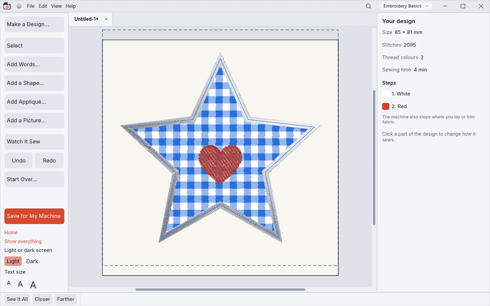
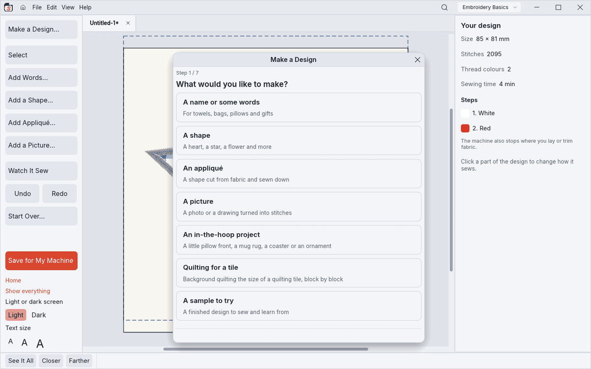
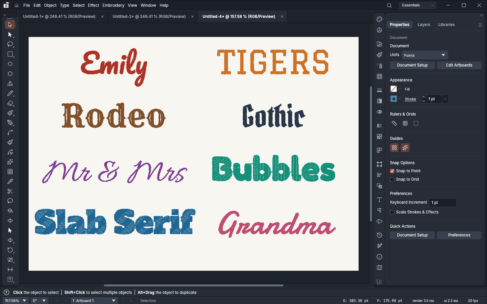
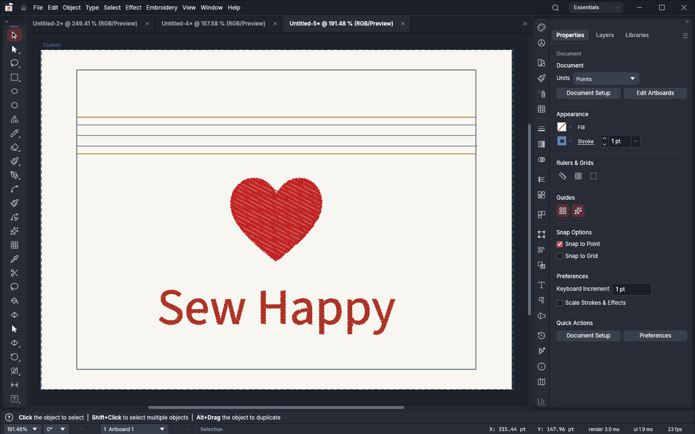
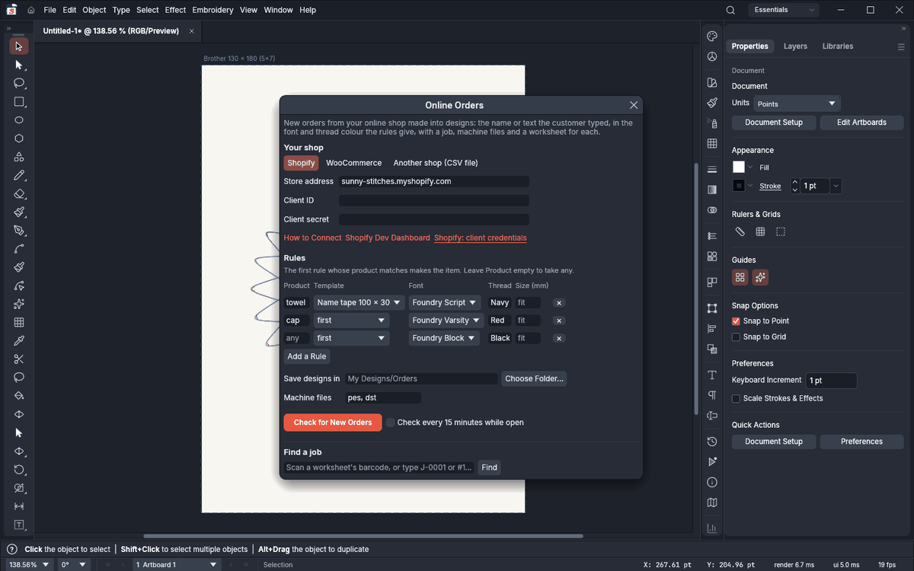
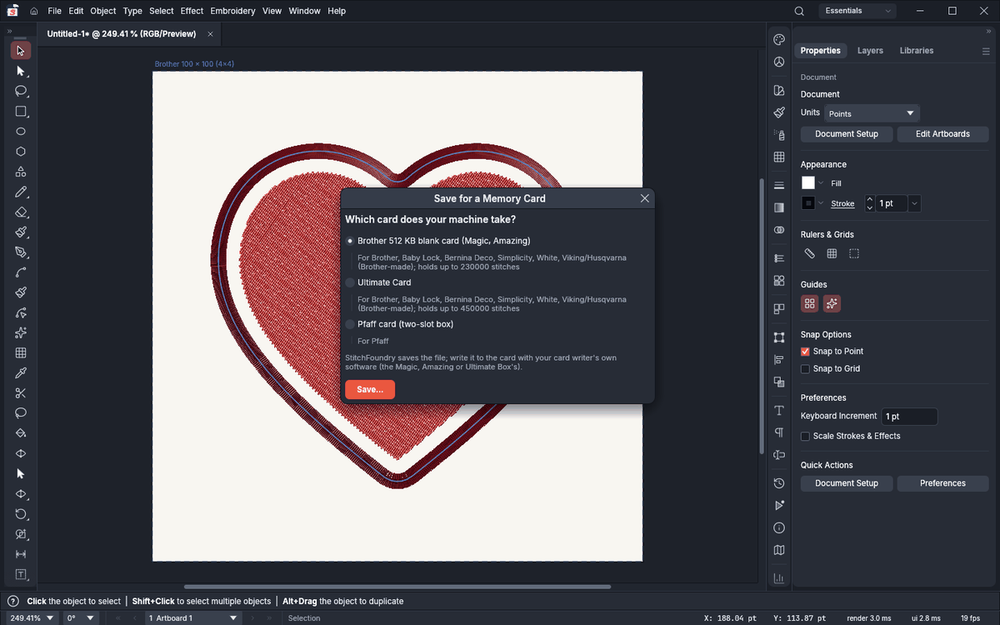
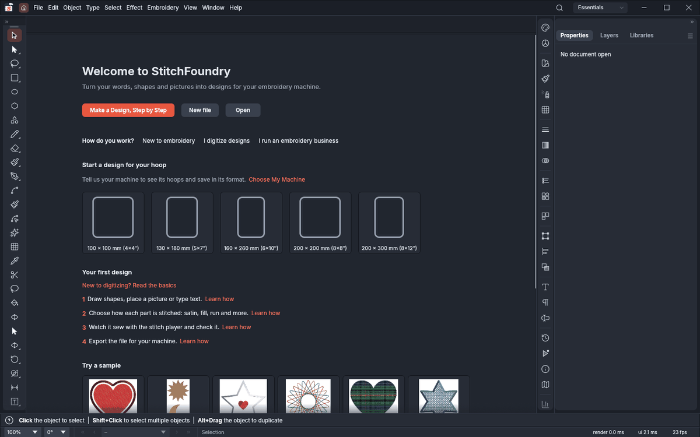
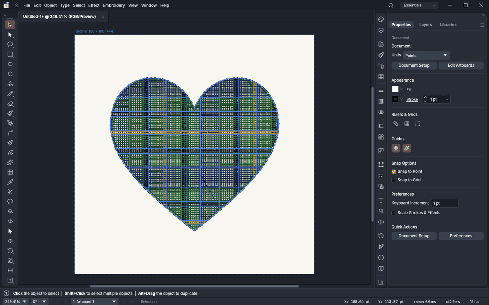

<p align="center">
  
</p>

<h1 align="center">StitchFoundry</h1>

<p align="center">
  <b>Open-source machine-embroidery digitizing, by SiteSentrix.</b>
</p>

<p align="center">
  Turn shapes, type and images into stitches, and write the files your embroidery machine reads.
  It runs natively on macOS, Windows, Linux and FreeBSD, and in the browser, and is written in pure
  Rust on top of the VectorCraft vector editor.
</p>

<p align="center">
  <a href="https://github.com/Stitchwright/StitchFoundry/actions/workflows/ci.yml"></a>
  
  
  
  
  
</p>

> [!NOTE]
> **Pre-release.** Every machine format round-trips in software, and files StitchFoundry writes are
> read correctly by an independent open-source embroidery library, but nothing has been sewn on a
> real machine yet: test-sew before production runs.

## Download

<p align="center">
  <a href="https://github.com/Stitchwright/StitchFoundry/releases/tag/v0.14.0-rc.1"><b>⬇ Download StitchFoundry 0.14.0 (release candidate 1)</b></a>
  (Windows, macOS, Linux; signed) ·
  <a href="https://stitchwright.github.io/StitchFoundry/"><b>Try it in your browser</b></a>
</p>

| System | File to download |
|---|---|
| Windows (64-bit, 32-bit or ARM) | `stitchfoundry-…-windows-x64.msi` (installer) or `…-portable.zip`; `…-x86` and `…-arm64` likewise |
| macOS (Apple silicon and Intel) | `stitchfoundry-…-macos-universal.dmg` |
| Linux (x86_64 or ARM) | `.AppImage` (runs anywhere), `.deb` (Debian, Ubuntu), `.rpm` (Fedora) or `.flatpak` |
| FreeBSD 14 | `stitchfoundry-…-freebsd-x86_64.tar.gz` |

The Windows installers and programs are signed, and the Mac app is signed and notarized by
Apple, so they open without a warning. The browser version is a demo: it can't download
embroidery fonts. Builds of every change since the release, unsigned, are on the
[latest build](https://github.com/Stitchwright/StitchFoundry/releases/tag/latest-build) page
(Windows may warn: **More info › Run anyway**, and Smart App Control blocks them: use the signed
release above; on macOS right-click › **Open** the first time).

<p align="center">
  
  <br><sub>Branching: thirty satin petals and a fill vine sewn as one thread, ordered in the Stitch Sequence panel</sub>
</p>

## What it does

### For everyone

- **Make a Design, step by step.** Pick words, a shape, an appliqué, a picture, an in-the-hoop
  project or quilting, then your hoop and fabric. StitchFoundry sets the density, underlay and pull
  compensation, and makes words smaller when they're too long for the hoop.
- **Simple mode** for people new to embroidery or to computers. It has big buttons, plain words and
  a light or dark screen. Thread colours have names ("Red", "Sky Blue") and sewing times read
  "7 min". **Save for My Machine** finds your USB stick and saves straight onto it.
- **39 embroidery fonts built in**: scripts, wedding, varsity, western, gothic, bubble and a 5 mm
  font for small text. 131 more are a free download away, and you can make your own in the font
  creator.
- **Photos to stitches.** Remove the background in one click (Select Subject, a cut-out brush),
  trace with the Magnetic Lasso, and Auto-Digitize with as many threads as you choose. Photo stitch
  styles include sepia, black and white and colour tiles.
- **In-the-hoop projects**: zipper pouch, pencil case, phone case, passport holder, book cover,
  key fob, luggage tag, bookmark, mug rug, coasters, ornaments and pillow fronts. Each comes with
  its steps and cut sizes.
- **Wizards**: Endless Border, Spiro, Repeat Design, Quilt Background, Quilt Block, Family Tree,
  monograms and patches.
- **Watch it sew** in the stitch player, and save it as a GIF or MP4. **See it on the product**:
  a cap, T-shirt, polo, hoodie, tote or towel, life size.
- **Nine sample designs** on Home, to sew and learn from.

### For digitizers

- **Stitch types on anything you draw.** Any path, shape or type can carry running stitches
  (single, triple, bean, motif), satin and satin columns, tatami and other fills, or appliqué.
  Edit the shape and the stitches follow.
- **Direction placed for you, then yours to change.** Stitch angles are chosen automatically and
  stay editable on the canvas with inclination lines and start and stop beads.
- **Fills and effects:**
  - texture patterns, carved lines, wave and radial fills, ragged edges;
  - satin density that varies along a column, or uneven on purpose for texture;
  - free-standing lace, eyelets, StumpWork, blackwork and candlewick motifs;
  - sequins, beads, cord and chenille.
- **Digitizing tools.** Column A/B digitizing, a radial digitizing widget with satin brushes,
  lettering from any font with kerning pairs and kerning classes, Fill Region from loose lines,
  and Auto-Digitize.
- **Stitch-level control.**
  - Edit single stitches and machine functions.
  - Split objects, and branch objects into one thread run.
  - Sequence automatically, and keep objects alike with styles.
  - Recolour a design lighter, darker or tinted, and remove stitches too short to sew.
- **Design checks** for dense areas, long stitches and lettering too small to sew, plus machine
  profiles, hoops, fabrics, thread charts and a design grade.
- **Design from Prompt and Redraw Image.** Describe a design, or select a logo, and AI draws it as
  clean flat-colour art that StitchFoundry digitizes in one step. Optional, paid in credits or
  with your own key.

### For embroidery businesses

- **Online orders.** Shopify, WooCommerce or any shop's CSV export (Etsy and others). Each
  personalized order becomes a design in the font and thread your rules choose. Each also gets a
  job order, machine files and a worksheet with a barcode. Find a job by scanning its barcode.
  Setup: [`docs/online-orders.md`](docs/online-orders.md).
- **Production:** stitch counts, sewing time, thread and cost estimates, quotes, colourways,
  batch output, hot folders and a lettering kiosk for the counter.

### Machine files

DST, PES and PEC, JEF, EXP, VP3, XXX, U01, PCS, TAP and DSB, to open and to save. Husqvarna HUS,
Janome SEW and Pfaff VIP are experimental. **Save for a Memory Card** writes the right file for
older machines' cards. Files StitchFoundry writes are checked against an independent reader.

[`docs/embroidery.md`](docs/embroidery.md) covers it all as you use it, and
[`CHANGELOG.md`](CHANGELOG.md) says what's new in each version.

## Screenshots

<table>
  <tr>
    <td width="50%"><br><sub><b>Simple mode.</b> Big buttons and plain words; Save for My Machine puts the design on your USB stick.</sub></td>
    <td width="50%"><br><sub><b>Make a Design.</b> Choose what to make and follow the steps.</sub></td>
  </tr>
  <tr>
    <td><br><sub><b>39 built-in fonts.</b> Eight of them, shown thread by thread as they will sew.</sub></td>
    <td><br><sub><b>In-the-hoop projects.</b> A zipper pouch, with every step and the cut sizes in its notes.</sub></td>
  </tr>
  <tr>
    <td><br><sub><b>Online orders.</b> Rules turn each personalized order into a design, a job, machine files and a worksheet.</sub></td>
    <td><br><sub><b>Memory cards.</b> Pick the card your machine takes; StitchFoundry saves the right file.</sub></td>
  </tr>
  <tr>
    <td><br><sub><b>Home.</b> Start a design the size of your hoop, follow the first steps or open a sample.</sub></td>
    <td><br><sub><b>Samples.</b> The tartan heart, one of nine finished designs.</sub></td>
  </tr>
  <tr>
    <td><br><sub><b>Appliqué, foil and print.</b> Fabric pieces with their tack-down and cover stitches, a foil star, a printed band and two motif runs.</sub></td>
    <td><br><sub><b>Sequins, stones, beads and cord.</b> Decorations placed along a line or filling a shape, with their holding stitches.</sub></td>
  </tr>
  <tr>
    <td><br><sub><b>Image to stitches.</b> Choose how many threads a picture becomes and preview it before Auto-Digitize.</sub></td>
    <td><br><sub><b>See it on the product.</b> The design life size on a cap, T-shirt, polo, hoodie, tote or towel before you sew it.</sub></td>
  </tr>
  <tr>
    <td colspan="2"><br><sub><b>Help built in.</b> Press F1 for the guide, including Digitizing basics: stitch lengths, density, underlay, pull and push compensation.</sub></td>
  </tr>
</table>

## Built on VectorCraft

StitchFoundry includes the full [VectorCraft](https://github.com/storytold/vectorcraft) editor: pen,
shape and brush tools, Pathfinder, type, gradients, live effects and artboards, and SVG, PDF, EPS,
DXF, EMF and raster files. Every action is an engine command, so agents can drive the app over a
JSON control channel and an MCP server the way a person does.

## Free and open source

StitchFoundry is free and open source. Its optional AI features (Design from Prompt, Redraw Image)
run on Foundry credits or your own AI provider's key.

## Build and run

Rust 1.97 or newer.

```sh
cargo run --release -p vectorcraft                          # the app (the program is stitchfoundry)
cargo run --release -p vectorcraft -- --control 7979        # + JSON control channel
cargo run --release -p vectorcraft-cli -- mcp               # MCP server (stdio)
cargo xtask ci                                              # fmt, clippy, tests, layering, wasm, vendor names
```

Japanese fonts come from the optional craft-fonts build input
(`CRAFT_FONTS_DIR="$PWD/../craft-fonts"`); without it, Japanese text uses the system fonts. See
[`docs/development.md`](docs/development.md) for graphics processors, Wayland and other platform notes.

## Docs

- [`docs/embroidery.md`](docs/embroidery.md): embroidery, as you use it
- [`docs/stitchfoundry-spec.md`](docs/stitchfoundry-spec.md): the build spec (architecture, feature
  matrix, roadmap, decisions)
- [`docs/mcp.md`](docs/mcp.md) and [`docs/control-protocol.md`](docs/control-protocol.md): driving it
  from agents
- [`AGENTS.md`](AGENTS.md): rules for contributors (clean-room, assets, no panics, quality gates)

StitchFoundry is written clean-room: behaviour comes from public documentation only, never from
commercial embroidery software.

## Reporting bugs

In the app, **Help → Report a Bug…** opens StitchHub's report page, filled in with the version and your system. **Help → Suggest a Feature…** opens the same page for an idea, which is emailed to us.
Describe what happened and send it: it becomes an issue in this repository (a public one, so leave out anything
private). You can also [open an issue](https://github.com/Stitchwright/StitchFoundry/issues) yourself. A maintainer can
have Claude work on an issue by labelling it `claude-fix`; Claude opens a pull request for review, and never merges.

## License and credits

StitchFoundry is dual-licensed under [MIT](LICENSE-MIT) or [Apache-2.0](LICENSE-APACHE), at your option.

Copyright (c) 2026 Bruce Wattendorf (SiteSentrix) and the StitchFoundry contributors.<br>
Copyright (c) 2026 ArtCraft Team and the VectorCraft contributors.

Required notices are in [NOTICE](NOTICE). Bundled fonts, icons, images and other assets keep their
own open licences; each one is listed with its author, source and licence in [ASSETS.md](ASSETS.md).
The app icon is original artwork; its files are in [`assets/app-icon/`](assets/app-icon/README.md).

### Where it comes from

The GitHub repositories StitchFoundry takes code, data or fonts from:

| Repository | What StitchFoundry uses | How |
|---|---|---|
| [storytold/vectorcraft](https://github.com/storytold/vectorcraft) | the whole vector editor StitchFoundry is built on | merged in from time to time (last: version 0.13.1, upstream `aa9c70a7`, 2026-10-19); MIT OR Apache-2.0 |
| [storytold/craft-libs](https://github.com/storytold/craft-libs) | the PDF reader (patched [hayro](https://github.com/LaurenzV/hayro) crates) | fetched at a pinned revision when building; MIT OR Apache-2.0 |
| [storytold/craft-fonts](https://github.com/storytold/craft-fonts) | the Japanese fonts | optional build input (release builds), never copied here; OFL |
| [adobe-fonts/source-sans](https://github.com/adobe-fonts/source-sans), [rsms/inter](https://github.com/rsms/inter), [JetBrains/JetBrainsMono](https://github.com/JetBrains/JetBrainsMono) | the interface fonts | copies in `assets/fonts` (from VectorCraft); OFL, listed in [ASSETS.md](ASSETS.md) |
| [EmbroidePy/pyembroidery](https://github.com/EmbroidePy/pyembroidery) | the Brother PEC and Janome JEF thread colour tables | copied once (version 1.5.1); MIT, notice in [NOTICE](NOTICE) |
| [Stitchwright/stitchfoundry-fonts](https://github.com/Stitchwright/stitchfoundry-fonts) | embroidery fonts | downloaded in the app (Embroidery › Embroidery Fonts › Get Embroidery Fonts…), not in this repository |
| [inkstitch/embroidery-fonts](https://github.com/inkstitch/embroidery-fonts) | embroidery fonts in Ink/Stitch's format | downloaded in the app, not in this repository; each font keeps its own licence |

Ink/Stitch itself is only a reference from its public documentation: none of its (GPL) code is used.
Every other dependency is an ordinary Rust crate from crates.io, listed in `Cargo.lock`.

StitchFoundry is based on [VectorCraft](https://github.com/storytold/vectorcraft) by the ArtCraft team.
It is an independent project, not made, sponsored or endorsed by the ArtCraft team.

<sub>Tajima, Brother, Janome, Melco, Pfaff, Husqvarna Viking, Singer and Barudan are trademarks of their
owners, named only to identify the file formats and hoops StitchFoundry works with. Adobe and Illustrator are
trademarks of Adobe Inc.; StitchFoundry is not affiliated with Adobe.</sub>
